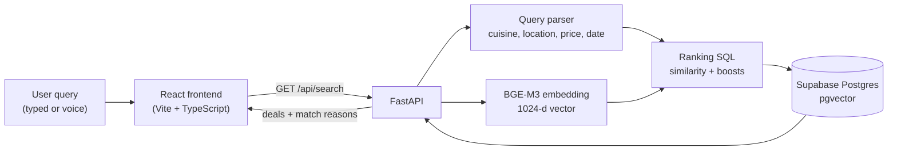

# MakanRadar

> Find food deals without the digging.


<!-- Live demo: add your deployed link here, e.g. **[Live demo](https://...)** -->
<!-- Screenshots: add a demo GIF or screenshots here, e.g.  -->

## Overview

MakanRadar is a semantic search app for food deals in Singapore. Promotions are often posted as free-form text on channels like Telegram, Instagram and Facebook, which makes them hard to find with keyword search. With MakanRadar you describe what you're craving in plain language, such as *"cheap Thai food near Clementi this weekend"*, and get back the best-matching deals, each with a short explanation of **why** it matched.

It is a full-stack project: a React + TypeScript frontend, a FastAPI backend, and a Postgres database with pgvector for vector similarity search.

## Demo

[](https://youtu.be/MlsfOS32Cq8)

## Features

**Search**
- **Natural-language semantic search.** Queries and deals are embedded with the multilingual BGE-M3 model, so queries match deals by meaning rather than exact keywords.
- **Query understanding.** A lightweight parser pulls out cuisine (16 cuisines, with dish aliases such as *sushi* → Japanese), location (28 Singapore neighbourhoods, with shorthand such as *amk* and *tp*), price (*cheap*, *moderate*, *under $15*) and dates (*today*, *tomorrow*, *this weekend*, *next week*, *this month*).
- **Hybrid ranking.** Semantic similarity is the main signal; parsed constraints add small score boosts rather than hard filters, so a strong semantic match is never discarded just because the parser missed a keyword.
- **Explainable results.** Every result shows an overall match percentage and "Why this matched" chips (for example *Thai cuisine*, *Clementi*, *Budget-friendly*, *Available this weekend*, or *Matches "fried chicken"*).
- **Voice search** through the browser's Web Speech API (Chrome and Edge; hidden where unsupported).
- **Browse mode.** An empty search lists the currently active deals, soonest-expiring first.

**Deal pages and UI**
- Cuisine and location multi-select filters on the results page.
- Deal detail page with a one-click promo-code copy, a Google Maps directions link, and a link back to the original promotion.
- Page transitions with the native View Transitions API, a typed-out wordmark animation, and a custom animated SVG loading burger that gets eaten bite by bite.
- Responsive layout, ARIA labels on icon buttons, and `prefers-reduced-motion` support.

## How it works



1. The query is parsed for cuisine, location, price and date constraints.
2. The full query is embedded with BGE-M3 into a 1024-dimension vector.
3. Postgres ranks deals by cosine similarity (pgvector's `<=>` operator). Matching constraints add a boost on top: **+0.10** cuisine, **+0.10** location, **+0.05** price, **+0.10** date overlap.
4. The API attaches human-readable match reasons to each result, including a dish-level keyword match that the structured constraints can't express.
5. The frontend shows the match percentage and reasons on each card.

**Example.** *"cheap Thai food near Clementi this weekend"* is parsed into `Thai`, `Clementi`, `cheap` and the coming Saturday–Sunday. A cheap Thai deal in Clementi that is valid that weekend can gain up to +0.35 on top of its semantic score.

**Data pipeline (one-off scripts in `backend/scripts/`)**

1. `load_deals.py` upserts `backend/data/mock/dataset.json` into the `deals` table.
2. `generate_embeddings.py` embeds each deal (restaurant, title, cuisine, location, discount, price and the original promo text) into the `embeddings` table.
3. `apply_pexels_images.py` backfills a food photo URL per deal from the Pexels API, so no image lookups happen at request time.

## Tech stack

| Layer | Technology |
| --- | --- |
| Frontend | React 19, TypeScript, Vite 8, Tailwind CSS v4, React Router 7 (data router), Heroicons |
| Backend | Python, FastAPI, Uvicorn, psycopg 3 with a connection pool |
| Search / AI | BGE-M3 (`BAAI/bge-m3`) via FlagEmbedding, 1024-dimension dense embeddings |
| Database | Supabase Postgres with the pgvector extension |
| Tooling | oxlint, Python `unittest` |
| External | Pexels API (one-off image backfill), Google Fonts (Inter, Modak) |

## Project structure

```
makanradar/
├── src/                          # React frontend
│   ├── api/deals.ts              # typed API client with request caching
│   ├── components/               # DealCard, MatchReasons, LoadingBurger, Wordmark, ...
│   ├── hooks/useSpeechRecognition.ts
│   ├── lib/format.ts
│   └── pages/                    # Home, SearchResults, DealDetail
└── backend/
    ├── src/
    │   ├── api.py                # FastAPI app and routes
    │   ├── search_engine.py      # ranking SQL, match reasons, connection pool
    │   ├── query_parser.py       # cuisine / location / price / date extraction
    │   └── embedding_service.py  # BGE-M3 wrapper
    ├── scripts/                  # load_deals, generate_embeddings, search_deals (CLI), apply_pexels_images
    ├── sql/init.sql              # schema: deals + embeddings (pgvector)
    ├── data/mock/dataset.json    # 105 sample deals
    └── tests/
```

## API

| Endpoint | Description |
| --- | --- |
| `GET /api/search?q=<query>&limit=<n>` | Semantic search (`limit` 1–20, default 10). Returns deals with `semantic_score`, `final_score` and `match_reasons`. A blank query returns an empty list. |
| `GET /api/deals?limit=<n>` | Currently active deals, soonest-expiring first (`limit` 1–100, default 20). |
| `GET /api/deals/{id}` | A single deal. Returns 404 if it does not exist. |
| `GET /api/filters` | The cuisine and location vocabulary the query parser recognises, used to populate the filter dropdowns. |

The API returns `503` when the database is unreachable. CORS allows local dev origins (`localhost` / `127.0.0.1` on any port) and Cloudflare Pages domains (`*.pages.dev`).

## Getting started

**Prerequisites:** a current Node.js LTS, Python 3, and a Postgres database with pgvector. The schema is written for Supabase, which installs extensions into an `extensions` schema.

```bash
git clone https://github.com/sealfromdowntown/MakanRadar.git
cd MakanRadar
```

### 1. Database

Create a Supabase project and run [`backend/sql/init.sql`](backend/sql/init.sql) in its SQL editor to create the `deals` and `embeddings` tables.

### 2. Backend

```bash
cd backend
python3 -m venv .venv
.venv/bin/pip install -r requirements.txt   # pulls in torch via FlagEmbedding, several hundred MB
```

Create `backend/.env`:

```bash
DATABASE_URL=postgresql://...   # your Supabase connection string
PEXELS_API_KEY=...              # optional, only needed for apply_pexels_images.py
```

Load the sample data and generate embeddings (one-off):

```bash
.venv/bin/python scripts/load_deals.py
.venv/bin/python scripts/generate_embeddings.py
.venv/bin/python scripts/apply_pexels_images.py   # optional: adds food photos
```

Start the API:

```bash
.venv/bin/uvicorn src.api:app --reload --port 8000
```

The BGE-M3 model downloads on first start (a few minutes) and is cached afterwards. Once warm, searches are sub-second. You can also try the search engine from the terminal:

```bash
.venv/bin/python scripts/search_deals.py "cheap Thai food near Clementi"
```

### 3. Frontend

From the repository root:

```bash
npm install
npm run dev
```

Open the URL Vite prints (typically `http://localhost:5173`). The frontend calls `http://localhost:8000` by default; to point it elsewhere, set `VITE_API_BASE` in a `.env.local` file.

Other scripts: `npm run build` (type-check and production build), `npm run lint`, `npm run preview`.

### Tests

```bash
cd backend
.venv/bin/python -m unittest discover -s tests
```

## Engineering notes

- **Boosts instead of filters.** Cuisine, location, price and date only nudge the ranking. If the parser misreads a query, good semantic matches still surface.
- **Deterministic query parser instead of an LLM.** Parsing is instant, free and predictable, at the cost of a fixed vocabulary.
- **Model warm-up at startup.** Loading BGE-M3 lazily inside a request's worker thread was observed to hang, so the API loads the model and opens the database pool on the main thread during startup.
- **Connection pooling.** Opening a fresh connection to Supabase on every request added roughly a second of latency, so the API keeps a small pool of warm connections.
- **Fewer repeated searches on the client.** Search results, browse lists and filter vocabulary are cached per page session, and match info is passed to the detail page through router state, so going back to results or opening a deal doesn't trigger a second embedding and database round trip.
- **Images stored, not fetched.** Photo URLs are written to the database once, so there are no third-party API calls at request time.

## Limitations & next steps

- The dataset is a 105-deal sample (September–October 2026) shaped like real channel posts; source links are placeholders. Replacing it with a real ingestion pipeline from the source channels is the natural next step.
- The "new deals this weekend" badge on the home page is static text.
- The query parser covers a fixed vocabulary of 16 cuisines and 28 locations; anything outside it is handled by semantic similarity alone.

## Author

Built by [@sealfromdowntown](https://github.com/sealfromdowntown) and [@edwardheww](https://github.com/edwardheww)

<!-- Credit any collaborators here. -->
